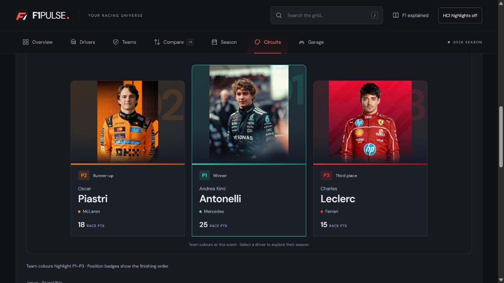
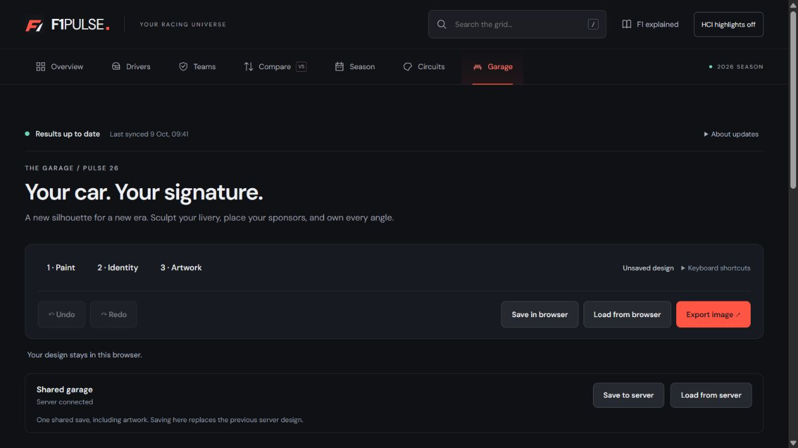
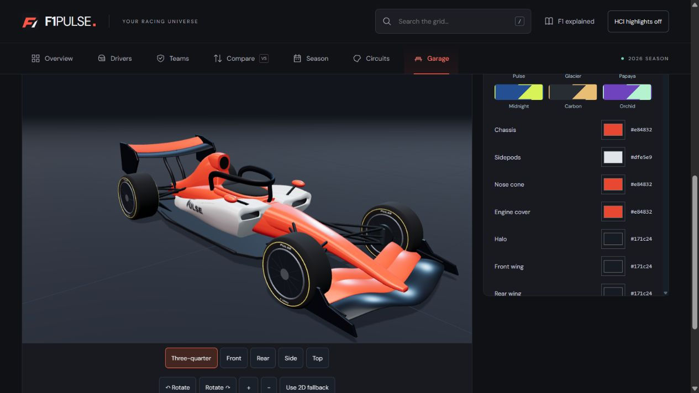
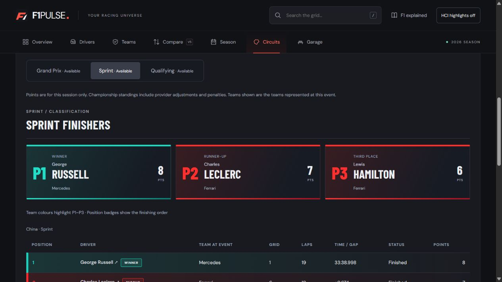

# F1 Pulse

### Explore the grid. Compare the drivers. Design your car.

F1 Pulse is a multi-page Formula 1 web application built for a **Human–Computer Interaction (HCI)** project. It brings season information, driver comparisons, circuit results, and an interactive 3D livery studio into one interface.

The project focuses on making common fan tasks easier to understand: finding a result, comparing drivers, interpreting a race weekend, and customising a car with clear feedback and reversible actions. It combines a React frontend with a small working Node.js backend for automatic published-result updates and persistent Garage saves.

> An independent educational prototype, not an official Formula 1 product. The 3D car is an original 2026-inspired visual concept, not a team-accurate or regulation-certified model.

[Website screenshots](#website-screenshots) · [Features](#features) · [Tech stack](#tech-stack) · [Run locally](#run-locally) · [HCI principles](#hci-principles) · [Official-site comparison](#comparison-with-the-official-f1-website)

## Website screenshots

Actual screenshots from the running project. Results and timestamps in these images are examples captured at that time, not a source of current standings.

### Grand Prix podium and results

Driver portraits, an elevated winner card, readable names, and team-colour accents make the top three easy to identify. Position labels provide meaning independently of colour.



### Garage workspace and update status

Paint, identity, and artwork are grouped into three steps. Save controls, undo/redo, and status feedback sit above the design studio. The compact results status exposes additional update information on demand.



### Interactive car model

The Garage includes a rotatable car with sculpted sidepods, recessed intakes, wings, suspension, and a halo. This close-up illustrates the model; the toolbar presentation is shown in the newer screenshot above.



### Sprint classification

Sprint results have their own top-three presentation, distinct from the Grand Prix podium, with team colours and explicit finishing positions.



## Features

| Area | What you can do |
|---|---|
| Overview | See a season summary, championship information, and upcoming racing context. |
| Drivers and teams | Browse profiles, supplied portraits and team artwork, and season statistics. |
| Compare | Select two different drivers, switch between 2026, career, and 2025 archive views, and explore chart presets, configurable metrics, and exact values. |
| Season | Explore the race calendar and championship progression. |
| Circuits | View track maps and switch between qualifying, sprint, and Grand Prix results for each weekend. |
| Result highlights | Identify the qualifying top ten, sprint top three, and Grand Prix podium using team colours and position labels. The qualifying top ten correspond to the Q3 group, not Q1 advancement. |
| The Garage | Orbit and zoom the 3D car, change paint and finish, place sponsor marks, upload artwork, and position custom text on different surfaces. |
| Design storage | Undo/redo changes, save/load in the browser or shared local server, and export an image. |
| HCI guide | Turn on header annotations to locate Norman and Shneiderman principles in the interface. |

The Garage also provides camera presets, a 2D fallback, artwork limits, and separate replace/add actions. A dark visual theme, red primary actions, team-colour highlights, and responsive layouts connect the pages. DM Sans handles readable interface text; Barlow Condensed supplies selected racing-style headings. Motion respects reduced-motion preferences.

## Tech stack

| Layer | Technology | Role |
|---|---|---|
| UI | React 19 + TypeScript | Reusable components, typed data, and interactive state. |
| Navigation | React Router 8 | Client-side page navigation and detail routes. |
| Build tools | Vite 8 | Development server, asset processing, and production builds. |
| Styling | CSS | Responsive layouts, team accents, typography, focus states, and transitions. |
| Animation | Motion + CSS animations | Interface transitions and visual feedback. |
| 3D | Three.js, React Three Fiber, Drei | Car geometry, materials, lighting, and camera interaction. |
| Backend | Node.js native HTTP and filesystem APIs | Local API, result synchronisation, validation, and file persistence. |
| Racing data | Jolpica F1 API | Published 2026 calendar, standings, qualifying, sprint, and race results. |
| Persistence | Browser storage + JSON files | Local design saves, shared server save, and last-successful result cache. |
| Quality checks | TypeScript, Oxlint, Node test runner | Type checks, linting, and backend integration tests. |

No database installation, authentication service, or API key is required. This project does not use Express or a hosted database.

## Run locally

### Requirements

- **Node.js 22.12 or newer** and npm. Check with `node --version` and `npm --version`.
- A modern browser; WebGL is needed for the 3D view. A 2D fallback is available.
- Internet access for the initial dependency installation and fresh racing data. Google Fonts also uses an external request; system font fallbacks are configured.

### Install and start

Open a terminal inside the **F1 app folder containing `package.json`**, not the parent assignment folder:

```powershell
cd "F:\SEM-7\ELECTIVES\DEPARTMENT-ELECTIVES\HCI\Project\F1"
npm install
npm run dev
```

If you cloned the project elsewhere, use the corresponding app path instead.

Open **http://127.0.0.1:5173**. The command starts both Vite and the backend at **http://127.0.0.1:3001**. Press **Ctrl+C** in that terminal to stop both.

### Commands

| Command | Purpose |
|---|---|
| `npm run dev` | Start frontend and backend together. |
| `npm run dev:client` | Start only the Vite frontend. |
| `npm run server` | Start only the backend. |
| `npm run build` | Type-check and generate the production frontend in `dist/`. |
| `npm run preview` | Preview an existing production build locally. |
| `npm run lint` | Run Oxlint. |
| `npm run test:api` | Run backend and racing-data integration tests. |

For a production-build **local preview**, run `npm run build`, then run `npm run server` and `npm run preview` in separate terminals. Open the URL printed by Vite. This is a local preview, not a production deployment configuration.

### Troubleshooting

| Symptom | What to check |
|---|---|
| `Missing script: dev` | You are likely in the parent folder. Change into `F1` and check that its `package.json` lists the scripts above. |
| PowerShell blocks `npm.ps1` | Use `npm.cmd install` and `npm.cmd run dev`. |
| Port 3001 or 5173 is already in use | Check whether the project is already running. Stop your previous instance with Ctrl+C before starting another. |
| Saved/snapshot data appears | Inspect **About updates** and `/api/health`. Keep the backend running and allow the next sync; provider data may not yet be published. |
| 3D is unavailable | Use the Garage's 2D fallback. Saved designs remain available. |
| Server save is unavailable | Start the backend. Browser save/load remains a separate option. |

## HCI principles

The interface applies **Norman's seven design principles** and **Shneiderman's eight golden rules**, using the terminology from the course materials. Enable **HCI highlights** in the header to display the implementation codes and explanatory guide. Switch it off for the normal website.

| Code | Principle | Implementation | Page |
|---|---|---|---|
| N1 | Knowledge in the world and in the head | Visible search labels, examples, graph definitions, and named artwork surfaces reduce guessing. | `/compare` |
| N2 | Simplify the structure of tasks | The Garage presents three steps: paint, identity, and artwork. Chart presets offer a ready-made starting point. | `/cars` |
| N3 | Make things visible | Selected controls, filter counts, the live car preview, and status messages show the result of an action. | `/cars` |
| N4 | Get the mappings right | Driver selectors match the chart legend; car surface choices switch to the relevant camera angle. | `/compare` |
| N5 | Use constraints | The same driver cannot occupy both comparison slots. Artwork limits and disabled undo prevent invalid actions. | `/compare` |
| N6 | Design for error | Garage undo/redo, reset confirmation, clear filters, and upload error messages provide recovery. | `/cars` |
| N7 | Standardize | Shared navigation, labelled form controls, familiar buttons, and visible keyboard focus work consistently across pages. | `/drivers` |
| S1 | Strive for consistency | The same navigation, button styles, headings, and active-state treatment recur throughout the site. | `/` |
| S2 | Enable shortcuts | Press / to focus global search. In the Garage, Alt+S saves, Alt+Z undoes, and Alt+Shift+Z redoes. Shortcuts ignore text fields. | `/cars` |
| S3 | Offer informative feedback | Result counts, selected chart settings, the live preview, and Garage status messages explain what changed. | `/drivers` |
| S4 | Give interactions closure | Saving, loading, exporting, and resetting end with a clear confirmation message. The Garage distinguishes saved and unsaved work. | `/cars` |
| S5 | Prevent errors and support recovery | Distinct-driver constraints, upload validation, separate artwork positions, and actionable empty states prevent or explain errors. | `/compare` |
| S6 | Permit easy reversal | Garage Undo and Redo reverse design changes, including reset. Filters have a clearly labelled reset action. | `/cars` |
| S7 | Keep users in control | Users choose the camera, chart, period, and artwork action. Reset is confirmed; HCI annotations can be switched off. | `/cars` |
| S8 | Reduce short-term memory load | Labels, current selections, chart legends, exact-data tables, and the artwork list keep relevant context visible. | `/compare` |

## Backend demonstration

1. Open Garage and change paint, text, or sponsors.
2. Choose **Save to server**; the response confirms the save time.
3. Change the design, then **Load from server** to restore it. Undo reverses the load.
4. Restart the project and load again: the design persists in `server/data/garage.json`.

Browser Save/Load remains separate. There is one shared local demo save, not a user-account system. Server saves include uploaded artwork. The 2026 racing pages now use automatic provider updates; career totals and the 2025 archive remain clearly labelled snapshots.

| Endpoint | Purpose |
|---|---|
| GET /api/health | Backend availability and racing sync status |
| GET /api/racing/2026 | Cached calendar, standings, race/sprint/qualifying results and freshness |
| PUT /api/garage/design | Validate and persist the complete design |
| GET /api/garage/design | Restore design and timestamp |

The API binds to localhost, validates input, limits request sizes, and writes atomically. Storage is excluded from Git. Request errors leave the browser design intact.

## Automatic racing updates

Run `npm run dev` as usual. The backend checks [Jolpica F1](https://github.com/jolpica/jolpica-f1/tree/main/docs) on startup and every 15 minutes while it is running. No API key is required. The browser checks the backend once a minute (more frequently during the first sync), updating pages without a reload. The app deliberately stays on the **2026 season** rather than silently changing years.

Updates include:

- Driver and constructor championship order and points, using the provider's standings rather than recalculating championship penalties.
- Calendar changes, completed races, next race and current-season driver statistics.
- Separate Grand Prix, sprint and qualifying tables on each circuit, with session points, grid, laps, status, time gaps and Q1/Q2/Q3 times when published.
- Current-season comparison graphs and weekend points, including sprint results before the Grand Prix is available.

**These are published results, not live timing.** Changes appear after the provider publishes them and the next successful polling cycle completes. Provider publication delays and outages are outside the app's control. Results and standings may be published at different times; the standings round is displayed explicitly. Qualifying P1 counts are labelled separately from final pole/grid positions. Team identity follows each driver's latest recorded session, not an independently verified future lineup.

The server caches the full successful response in ignored `server/data/racing-2026.json`. Requests are paced and paginated; simultaneous refreshes share one request sequence. An incomplete refresh cannot replace the saved data. Failures/timeouts and HTTP 429 responses retain the cache and back off (honouring `Retry-After`). The status strip distinguishes current, saved/stale and bundled fallback data. Restarting restores the server cache before checking for updates. When both the API and its cache are unavailable, the original bundled snapshot keeps the frontend usable.

Career totals, the 2025 archive, track dimensions, photographs and explanatory content remain local reference data. New drivers without supplied portraits receive the existing placeholder. Nothing is presented as a live career-statistics feed.

For a presentation: open a circuit such as China, switch between Grand Prix/Sprint/Qualifying, then show `/api/racing/2026` and the sync status in `/api/health`. `npm run test:api` also simulates new points, a sprint-only weekend, pagination, provider failure, cache restart and recovery without depending on the real provider.


## Comparison with the official F1 website

The [official Formula 1 website](https://www.formula1.com/) serves a much broader audience and business purpose. Its homepage links to news, videos, schedules, results, standings, drivers, teams, live timing, and commercial services such as tickets, the store, and F1 TV (reviewed 9 October 2026).

This comparison explains **the prototype's design focus**, not a claim that the official site lacks all similar features. No controlled usability study has established that F1 Pulse is faster or more accessible.

| Design question | Official F1 website / scope | F1 Pulse approach |
|---|---|---|
| What is the main purpose? | A broad official destination for racing information, editorial content, media, and fan services. | A focused coursework interface for exploration, comparison, and car customisation. |
| How is navigation organised? | Multiple content and service destinations reflect the breadth of the official offering. | Seven primary areas keep the project's smaller task set visible and consistent. |
| How are results explored? | Official results and standings are dedicated destinations. | Circuit pages place qualifying, sprint, and Grand Prix sessions together, with visual top-finisher summaries. |
| How does the project support analysis? | Official driver, team, and standings content provides racing context. | A dedicated two-driver workspace offers period selection, graph controls, and exact values together. |
| What interactive learning is emphasised? | The homepage links to newcomer information and fan activities. | The Garage demonstrates paint, decals, camera mapping, constraints, undo/redo, and save feedback in one task. |
| How is freshness communicated here? | The official offering includes a Live Timing destination. | A status strip states when published data was synced; this project does not provide live timing. |
| How are HCI choices demonstrated? | A public-facing product serving its audience. | Optional annotations explicitly map interface decisions to course principles for assessment. |

The intended benefits are lower memory load, clearer task progression, easier recognition of key results, and recovery from mistakes. These remain design hypotheses to validate through testing. The official site has a much broader editorial and service offering; this prototype is not a replacement for it.

### Suggested usability evaluation

Ask participants to find a circuit's qualifying top ten, compare two drivers, and customise then restore a Garage design. Record completion rate, time on task, errors, and participant comments. For tasks supported by both sites, use the same task wording and alternate the order of sites. Evaluate the Garage separately rather than forcing an unequal comparison.

## Presentation walkthrough

1. Show the overview and expand **About updates** to explain freshness and the provider.
2. Open a completed circuit and switch between qualifying, sprint (where available), and Grand Prix results.
3. Open Compare, select two drivers, change the period, and explore a graph alongside exact values.
4. In Garage, change paint and add artwork at separate positions. Undo and redo a change.
5. Save to the server, change the design, and load it again to demonstrate persistence.
6. Enable **HCI highlights** and explain selected Norman and Shneiderman implementations.

## Limitations and asset credits

- Racing updates are published-result polling, not live telemetry. The backend must be running for scheduled refreshes.
- Career and 2025 archive statistics are local snapshots; artwork, track dimensions, and explanatory text are reference content.
- There is one shared local Garage save, with no accounts or multi-user permissions. Treat the backend as a local demonstration service.
- The 4.5-second intro is a presentation choice; reduced-motion support stops its animation but does not remove the minimum wait. Its effect on task speed should be evaluated.
- The 3D model is a visual concept. The 2D fallback does not reproduce all 3D lighting and material effects.
- Supplied driver photographs, team logos, and circuit maps remain the property of their respective owners. Their inclusion does not grant redistribution rights. Portraits may depict a different season from the event data.
- Sponsor presets are fictional. The project is not affiliated with or endorsed by Formula 1, the FIA, or any team.

See [the HCI implementation guide](docs/HCI-IMPLEMENTATION.md) for the in-app principle map, and [Jolpica's documentation](https://github.com/jolpica/jolpica-f1/tree/main/docs) for the racing-data source.

## Folder map

- `src/components/` — shared UI; `loading/` contains the intro and bootstrap.
- `src/pages/` — website pages and comparison charts.
- `src/garage/` — car model, editor, design logic, API client.
- `src/data/` — fallback snapshots, live-data adapter, shared React provider and context.
- `src/assets/` — supplied photographs, maps, and optimized assets.
- `src/styles/` — shared style refinements.
- `server/` — Node API and racing sync; generated saves go in `data/`.
- `tests/server/` — backend persistence and racing-data integration tests.
- `scripts/` — combined development launcher.
- `public/` — static public icons.
- `docs/` — HCI and asset documentation, `reference/` documents, `previews/` screenshots, and `previews/archive/` older design captures.

Root configuration files are required by Vite, TypeScript, and npm. `dist/` and `node_modules/` are generated, ignored folders. Parent-folder assignment/PPT materials are preserved.


See [the project structure guide](docs/PROJECT-STRUCTURE.md) for what each root configuration file does and where new files belong.
